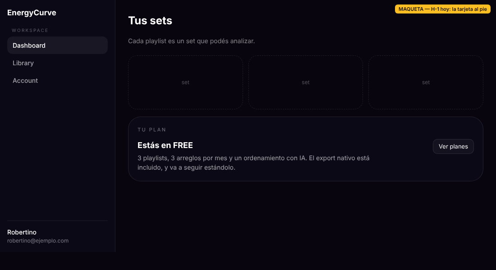
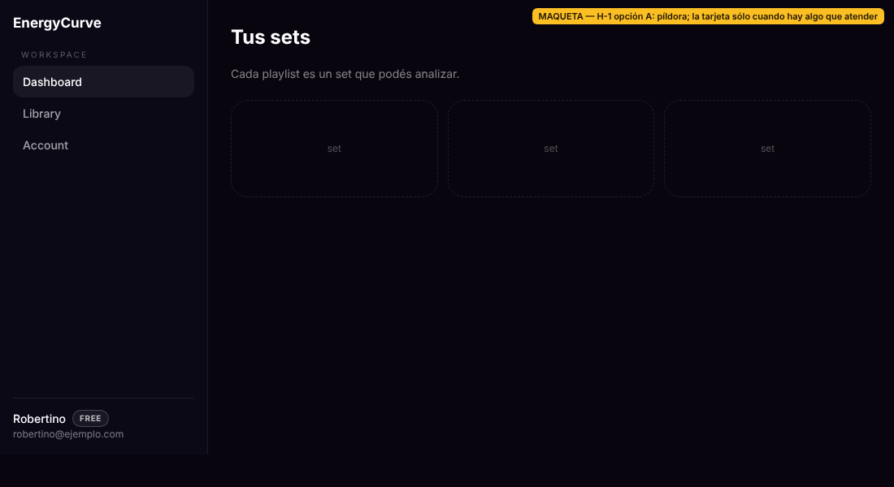
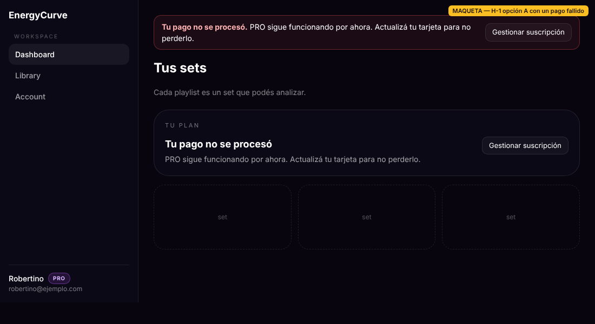
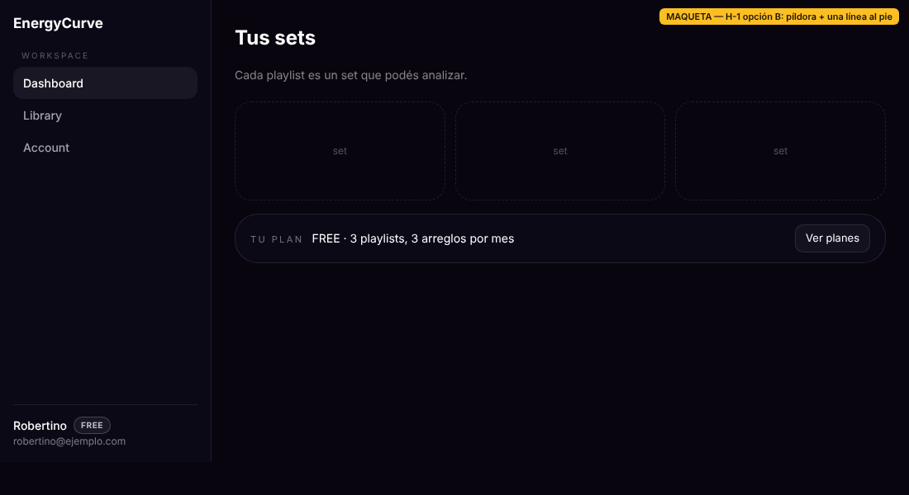
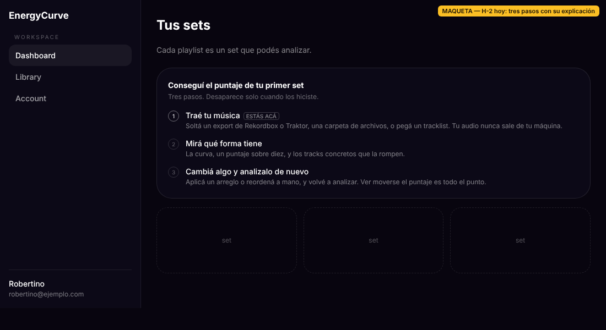
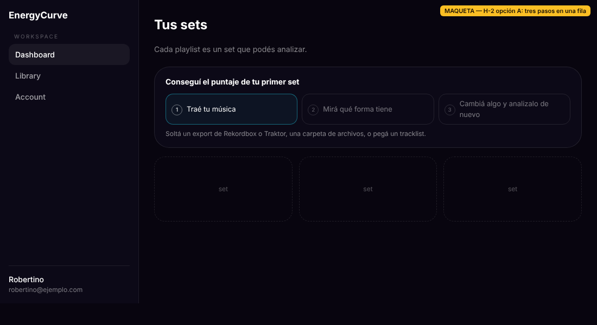
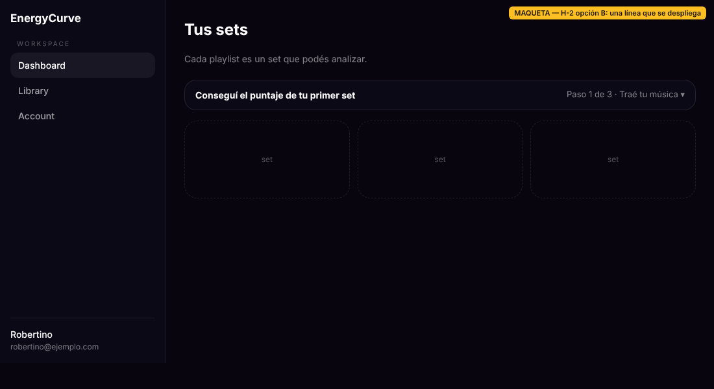

# H-1 y H-2 — dos opciones cada una, para que decida Robertino

Lote 21, 21/10/2026. **Nada de esto está implementado.** Las imágenes son
**maquetas** (HTML hecho a mano con el copy real en español, marcadas
«MAQUETA» arriba a la derecha), no capturas del producto: sirven para ver la
forma, no para validar estilo ni accesibilidad.

Hallazgos de origen: `docs/qa/output-test-tanda-01.md`, H-1 y H-2.

---

## Lo que hay hoy, leído en el código

**Los siete estados del plan** (`lib/product/plan-summary.ts`, `planNotice`):
`free`, `active`, `ending`, `ended`, `pastDue`, `unpaid`, `incomplete`.

| Estado | Franja en todas las páginas (`BillingAlertStrip`, en `dashboard/layout.tsx`) | Tarjeta del plan en el dashboard |
|---|---|---|
| `pastDue` (pago fallido) | ✅ | arriba |
| `unpaid` | ✅ | arriba |
| `ended` | ✅ | arriba |
| `ending` (cancelada, vence) | ❌ | arriba |
| `incomplete` (checkout abandonado) | ❌ a propósito: no se cobró nada | arriba |
| `free` | ❌ | abajo |
| `active` | ❌ | abajo |

«Arriba» es `planNeedsAttention()`: `actionable || kind === "ending"`.

Tres cosas que deciden las opciones:

1. **El pago fallido ya avisa en todas las páginas.** La franja cubre
   `pastDue`, `unpaid` y `ended`, y su enlace lleva a
   `/dashboard?billing=update`.
2. **La tarjeta es el único lugar para `ending` e `incomplete`.** Si se saca la
   tarjeta en esos estados, esos avisos desaparecen.
3. **El botón que abre Stripe (`ManageBillingButton`) sólo existe dentro de la
   tarjeta.** La tarjeta se muestra en el dashboard y en Account. Un suscriptor
   necesita ese botón para cambiar la tarjeta o cancelar, y los textos de
   borrado de cuenta lo mandan a «Gestionar suscripción».

---

## H-1 · El plan como etiqueta del usuario

*Hoy: un usuario FREE ve la tarjeta al pie del dashboard en cada visita.*

### Opción A — Píldora en el sidebar; la tarjeta del dashboard sólo cuando hay algo que atender

- Al lado del nombre, en el sidebar (`dashboard-shell.tsx`, que ya recibe
  `name` y `email`), una píldora `FREE` / `PRO` / `PRO+` que enlaza a
  `/pricing` (FREE) o a Account (pagos).
- En el dashboard, la tarjeta deja de renderizarse abajo (`free` y `active`).
  Arriba sigue igual: los cinco estados de `planNeedsAttention`.
- En Account la tarjeta queda como está, con el botón de Stripe.

**Dónde aparece el aviso de pago fallido:** en el mismo lugar que hoy, sin
cambios. La franja roja en todas las páginas, más la tarjeta arriba del
dashboard.

`ending` e `incomplete` también conservan la tarjeta arriba, porque son parte
de `planNeedsAttention`.

**Gana:** el dashboard de un usuario sano queda limpio, y es lo que pidió el
hallazgo. Los avisos no cambian.
**Pierde:** un usuario FREE ya no ve «Ver planes» ni la lista de límites en el
dashboard; sólo le queda la píldora. Un suscriptor activo tiene que ir a
Account para abrir Stripe.

### Opción B — Píldora en el sidebar, y una línea al pie en lugar de la tarjeta

- La misma píldora.
- En los estados `free` y `active`, la tarjeta del pie pasa a ser **una sola
  línea**: el plan, sus límites y el botón («Ver planes» o «Gestionar
  suscripción»).
- En los cinco estados de atención, la tarjeta completa sigue arriba.

**Dónde aparece el aviso de pago fallido:** igual que hoy y que en A. La
franja en todas las páginas, más la tarjeta completa arriba del dashboard. La
línea al pie es sólo para los estados sanos.

**Gana:** ocupa una línea en vez de un bloque, y ningún botón cambia de
lugar: el upgrade y el portal de Stripe siguen en el dashboard.
**Pierde:** el plan sigue en dos lugares (píldora y línea), y el dashboard
sano no queda del todo limpio. Es un componente más que mantener en los dos
idiomas.

**Recomendación:** A, si Robertino acepta que el upgrade de un usuario FREE
viva en la píldora y en `/pricing`. Si el upgrade desde el dashboard importa
para conversión, B. En ninguna de las dos el pago fallido se vuelve más
silencioso, que era la trampa del hallazgo.

---

## H-2 · El bloque de primera vez ocupa demasiado

*Hoy: `firstRun` en `lib/content/dashboard-copy.ts`. Título, subtítulo, tres
pasos con su explicación. Se descarta solo cuando se completan.*

### Opción A — Los tres pasos en una fila, una sola explicación

- Los tres pasos van en una fila de chips. El paso actual está resaltado y los
  hechos, tachados o con tilde.
- Debajo va una sola línea: la explicación del paso actual. Sale del mismo
  copy de hoy, sin texto nuevo.

**Gana:** el bloque baja a poco más de la mitad de alto y se ve el progreso
de un vistazo. Sigue usando el copy existente.
**Pierde:** las explicaciones de los pasos 2 y 3 dejan de verse hasta que les
toca. Además, «Tu audio nunca sale de tu máquina», que hoy está en el paso 1,
queda cortado en la maqueta; habría que decidir si entra en la línea.

### Opción B — Una línea que se despliega

- Cerrado, el bloque es una sola fila: «Conseguí el puntaje de tu primer set
  · Paso 1 de 3 · Traé tu música ▾».
- Abierto, es el bloque de hoy, dentro de un `
` nativo: teclado y
  lector de pantalla sin código extra.

**Gana:** es lo más compacto posible, y no se pierde nada del texto: está a un
clic.
**Pierde:** para un usuario recién llegado, que es el único que lo ve, una
línea cerrada es fácil de ignorar justo cuando más la necesita. Además, hay
que decidir si el estado abierto o cerrado se recuerda entre visitas, y eso
es estado nuevo.

**Recomendación:** A. El bloque existe para el primer minuto, y en ese minuto
conviene que se vea entero el camino. B lo esconde.

---

## Lo que tiene que decidir Robertino

- H-1: A o B (o ninguna).
- H-1, si elige A: confirmar que el upgrade de FREE puede vivir sólo en la
  píldora y en `/pricing`.
- H-2: A o B.
- H-2, si elige A: si «Tu audio nunca sale de tu máquina» entra en la línea.

Con la decisión, cada una es un lote chico: un componente, el copy en los dos
idiomas y los e2e de `dashboard` y `subscription-billing` actualizados. Fila
del banco: L21.9.
